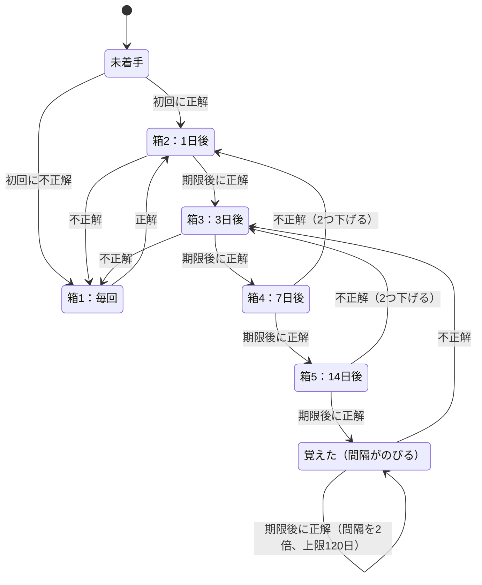
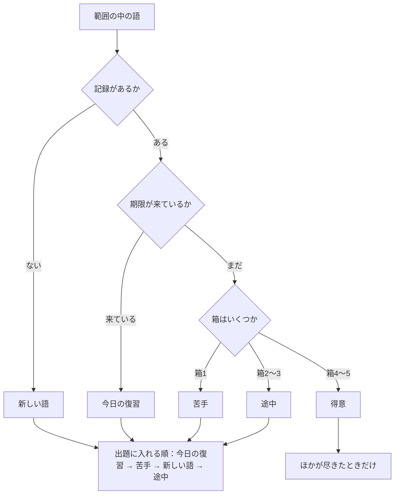
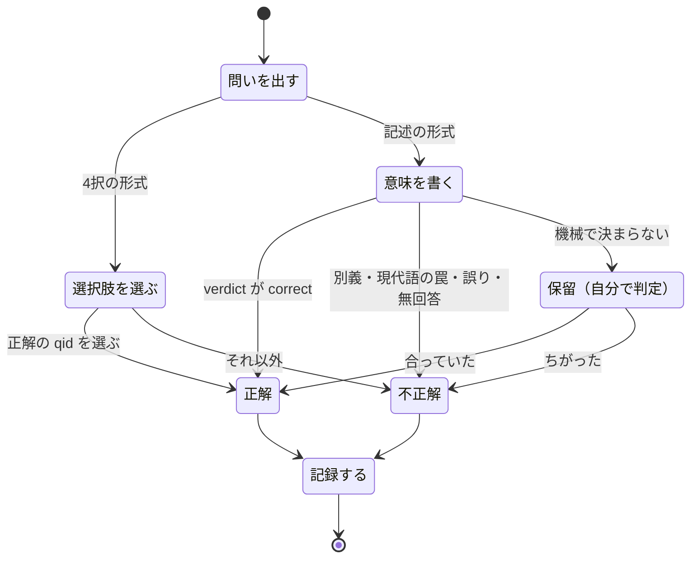
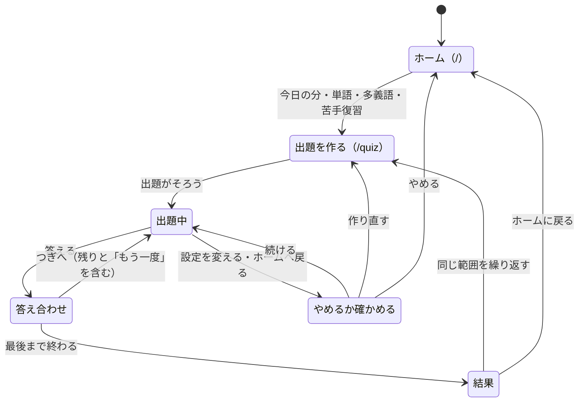
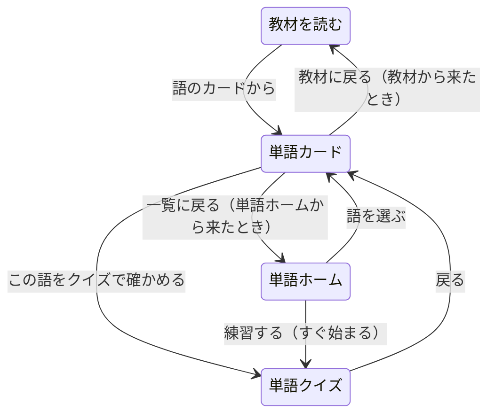

# 古文単（kobun-tan）── 状態遷移の見直し案

作成 2026-11-06。`docs/system-overview.md` の図（画面のつながり・単語クイズの状態・1問の状態・単語の箱・出す語の決め方・シーケンス図）を見直し、「もっとよい状態遷移にできる所」をまとめた。
**実装の状態（2026-11-06）：案 B・C・D・E は実装した**（同日。`system-overview.md` の図はそのあとの作りに直してある。下の「弱点」の表と案の文は、実装する前の作りについて書いたもの）。**案 A（画面の状態を1つにまとめる・アドレスを分ける）はまだ**。
案 C は、こちらで決めた値で入れた：箱4・5の不正解は2つ下げる／卒業後の間隔は あいた日数の2倍・下限28日・上限120日。今の作りの正本は `system-overview.md` とコード。数字は 2026-11-06 に本番の `srs_state` を読み取りだけで数えたもの（道具と結果 = `F:\A2A\_work\kobun-ia\srs-load.mjs`・`srs-load.txt`）。
対象は単語の側。文法道場は別に見直し中（`F:\A2A\_work\kobun-ia\grammar-dojo-review.md`）。

---

## 1. 結論

いちばん効くのは次の3つ。どれも画面の見た目はほぼ変えない。

1. **復習の予定を持つ仕組みを1本にする。** 今は「箱と期限（SRS）」と「正誤の累計での苦手・得意」の2本立てで、互いに食い違う。出す語の決め方を箱と期限だけにそろえると、「今日の分」と「ふつうの出題」が同じ1つの流れになる（案 C・D）。
2. **箱5のあとに終わりを作る。** 今は箱5の語も14日ごとに永遠に戻ってくるので、覚えた語が増えるほど復習が追いつかなくなる。直近60日に復習した116人のうち79人は、期限が来た語が1日の上限（10語）より多い（案 C）。
3. **抜け道と行き止まりをふさぐ。** 記述で「保留」のまま進むと何も記録されない。単語カードを読み終えると次の一手が無い。単語ホームの「練習する」はクイズが始まらない（案 B・E）。

画面の状態を1つの変数にまとめる直し（案 A）は効果が大きいが、`App.tsx` の作り替えになるので最後に回す。

---

## 2. 図から見えた弱点

| # | どの図 | 何が起きるか | 根拠 |
|---|---|---|---|
| 1 | 5 単語の箱 | 箱5の語は正解しても箱5のまま、14日ごとにずっと戻る（終わりが無い） | `src/lib/srsEngine.ts` の `nextBox`（上限5）・`BOX_INTERVALS_DAYS` |
| 2 | 5・9 | 復習が追いつかない。期限が来た語は、直近60日に復習した116人の中央値で21語、79人が11語以上、18人が101語以上。1日の上限は10語 | `srs-load.txt`、`DAILY_REVIEW_CAP` |
| 3 | 5・6 | 苦手・得意を決める物差しが2つある。箱が5でも、昔の誤答が多いと「苦手」に入り続ける（誤答率を先に見るため） | `src/lib/quizSelector.ts` の `classify`（誤答率40%以上を、箱4以上より先に判定） |
| 4 | 6・9 | ふつうの出題（おまかせ）は「期限が来たか」を見ない。期限前に正解しても箱は進まないので、ふつうの出題ばかり使う人は復習の予定とかみ合わない | `pickQuestions` の入力に期限が無い、`reviewTransition`（期限前の正解は据え置き） |
| 5 | 5 | 1回の不正解で、どの箱からでも箱1へ落ちる。箱5（記述で出る）で1回書きそこなうと、いちばん易しい4択からやり直しになる | `nextBox`（不正解は常に1）、`App.tsx` の形式の決め方（箱5＝記述、箱1＝語から意味） |
| 6 | 4 1問の状態 | 記述で「保留」になったとき、自分で判定しなくても「つぎへ」で進める。その回答は記録されず、点にも箱にも入らない | `src/components/quiz/WordQuizContent.tsx` の「つぎへ」（保留でも出る）、`App.tsx` の `handleWritingSubmit` |
| 7 | 3 画面の状態 | 出題中も設定（範囲・形式・問題数）が出ていて、変えると黙って出題を作り直す。途中の回答は消える | `App.tsx` の出題を作る `useEffect`（範囲・形式・問題数に反応） |
| 8 | 2・3 | ホームと単語クイズが同じアドレス `/`。クイズ中に再読み込みするとホームに戻り、ブラウザの「戻る」はアプリの外へ出る。クイズへ直接つなぐ道が無い | `App.tsx` の `showHome` |
| 9 | 2 | 単語ホームの「練習する」は `/` へ移るだけで、ホームが出る（クイズは始まらない） | `src/pages/VocabHome.tsx` の `startPractice` |
| 10 | 2 | 単語カードは読み終えると行き止まり。クイズで確かめる道が無く、教材から来ても「← 単語」（単語ホーム）へ戻る | `src/pages/VocabCard.tsx` |
| 11 | 3 | 画面の状態を5つの変数の組み合わせで持っている（`showHome`・`isQuizActive`・`showResults`・`currentQuestionIndex`・`currentQuizData`）。ありえない組み合わせを防ぐ手当てがコードの各所にある | `App.tsx`（「6/5 と表示される」「終わらない」「モード切替で出題が出ない」の手当てのコメント） |
| 12 | 7・8 | 選択肢を1問ずつ別々に取りに行く（10問なら10回）。回答の記録は2つの表へ別々に書く（片方だけ失敗しうる） | `App.tsx` の `/api/getChoices` の呼び方、`recordAnswer`・`updateSrsState` |

2 の数字の読み方：`srs_state` の単語の行は 19,661。そのうち 96.9% が期限切れだが、記録のある575人のうち直近60日に復習したのは116人で、多くは使わなくなった人の行。上の「79人」「18人」は、いま使っている116人の中の数。

---

## 3. 案

### 案 C：単語の箱に「卒業」を作る

- **卒業**：箱5で期限後に正解したら、次の復習までの間隔を「前回からあいた日数の2倍」にする（28日 → 56日 → 112日、上限120日）。箱の番号は5のままでよい（DB の決まりは箱1〜5。`supabase/migrations/001_word_tracking.sql`）。使うのは今ある `last_review` と `next_review` だけで、表は変えない。
- 効き目の見積もり：意味は約750。全部が箱5で14日おきなら1日あたり約53語が期限になり、上限10語では追いつかない。間隔が120日までのびれば1日あたり約6語に収まる。
- **落ち方をゆるめる**（任意。教員の判断）：箱4・5での不正解は箱1ではなく2つ下げる。1回の書きそこないで、いちばん易しい4択まで戻さないため。箱2・3は今までどおり箱1へ。
- 変えるのは `src/lib/srsEngine.ts` の `nextBox`・`reviewTransition` とテスト。全員の復習の予定に効くので、入れる前に数字で確かめる（未確認の欄）。

### 案 D：出す語の決め方を、箱と期限にそろえる

- 物差しを箱と期限の1本にする。正誤の累計（誤答率）は、箱の記録が無いときだけ使う（今の `classify` の後半と同じ）。
- 「今日の分」と「ふつうの出題（おまかせ）」が同じ決め方になる。違いは範囲と問題数、おかえりの語を付けるかどうかだけ。`composeTodaySet` と `pickQuestions` を1つの関数にまとめられる。
- ふつうの出題でも期限が来た語が先に出るので、どの入口から解いても箱が進む（弱点4の解消）。
- 新しい語の枠（今日の分に毎日3語。未コミット）はそのまま生かす。
- 変えるのは `src/lib/quizSelector.ts`・`src/lib/todaySession.ts` とテスト。画面は変わらない。

### 案 B：1問の状態から「記録しない」をなくす

- 保留のあいだは「つぎへ」を出さない（吹き出しの側はすでに、判定が済むまで進めない作り）。出口は「合っていた」「ちがった」の2つだけになる。
- 変えるのは `App.tsx` の `handleWritingSubmit`（保留のとき `setNextButtonVisible(true)` を呼ばない）の1か所。小さい。

### 案 A：画面の状態を1つにまとめ、アドレスを分ける

- 状態を1つの変数（`phase` = `home`・`setup`・`asking`・`feedback`・`result`）で持つ。5つの変数の組み合わせをやめるので、ありえない組み合わせが作れなくなる。
- クイズを `/quiz` に分ける。再読み込み・ブラウザの「戻る」・ほかの画面からの直リンクが素直に動く。単語ホームの「練習する」（弱点9）もこれで直る。
- 出題中は設定を畳む。変えるときは「今の出題をやめて作り直しますか」を1回聞く（弱点7）。
- `App.tsx`（約2,300行）の作り替えになる。段を分ける：①`phase` を今の変数から計算して読むだけにする → ②書く側を `phase` に寄せる → ③アドレスを分ける。各段でテストと画面の確かめを入れる。

### 案 E：行き止まりをなくす（画面のつながり）

- 単語カードに「この語をクイズで確かめる」を足す。道具はすでにある（`quizUrlWithReturn`。教材の語のカードが使っている）。
- 単語カードの戻り先を、来た所にする（教材から来たら教材へ）。
- 単語ホームの「練習する」は、押したらクイズが始まるようにする（案 A のアドレス分けの前でも、`/?mode=word` のような印で直せる。2026-11-05 に一度作って確かめた差分が `F:\A2A\_work\kobun-ia\reorg-2026-11-05\App.tsx.full.patch` にある）。

### そのほか（状態ではなく通信の形）

- 選択肢を1回でまとめて取る（10問ぶんを1回の呼び出しに）。出題を作る時間が短くなり、失敗の形が1つになる。
- 回答の記録（`word_stats` と `srs_state`）を、DB の関数1つにまとめて同時に書く。片方だけ失敗する形がなくなる。DB の関数を足す作業が要るので、急がない。

---

## 4. 入れる順（おすすめ）

| 順 | 案 | 大きさ | 画面の変化 | 学習の記録への影響 | 状態 |
|---|---|---|---|---|---|
| 1 | B：保留のまま進めない | 小 | 保留のとき「つぎへ」が出ない | 記録もれが減る | 実装済み |
| 2 | E：単語カードからクイズへ・戻り先・「練習する」 | 小 | ボタンが1つ増える | なし | 実装済み |
| 3 | D：出す語の決め方を箱と期限に | 小〜中 | 「前回の内訳」に「復習 N」 | 出る語の顔ぶれが変わる（期限が来た語が先） | 実装済み |
| 4 | C：卒業と落ち方 | 中 | なし | 全員の復習の予定が変わる | 実装済み（数字の確かめはまだ） |
| 5 | A：状態を1つに・アドレスを分ける | 大 | 出題中の設定の出方 | なし | まだ |

3 と 4 は純関数とテストだけで作れて、画面は変わらない。4 は教員の判断（落ち方をゆるめるか、間隔の上限を何日にするか）を先に決める。

---

## 5. 未確認のこと

- 案 C の数字（1日あたりの期限の語数）は、全部の意味が箱5にある場合の計算。実際の生徒の箱の分布で、間隔をのばしたあとに1日何語になるかは、まだ数えていない。
- 弱点3（箱が高いのに苦手に入り続ける語）が実際に何語あるかは数えていない。
- 弱点6（保留のまま進んだ回数）は記録に残らないので数えられない。
- 弱点7（出題中に設定を変えて途中の回答が消えた回数）も記録が無い。
- 案 A のアドレス分けで、今のブックマークや教材からのリンク（`/?qid=…`）がそのまま動くようにする作りは、未設計。
