# 古文単（kobun-tan）── 図で見る仕組み

作成 2026-11-06（同日、状態遷移の見直し B・C・D・E と文法道場の見直しを入れたあとの作りに直した）。対象は `F:\A2A\apps-released\kobun-tan`。
文章の正本は `CLAUDE.md`（担当範囲の表）と `docs/` の各設計書（`quiz-chat-feedback.md`・`learning-events-design.md`・`reading-test.md`・`word-card-plan.md` ほか）。本書は地図で、正本ではない。
図の名前は実際の関数名・表の名前・アドレスを使っている。文法道場の中の状態は、入口だけを書いた（中身は `CLAUDE.md` の「文法道場の見直し」の行）。

目次：1 全体像／2 画面のつながり／3 単語クイズの画面の状態／4 1問の状態／5 単語の箱（SRS）／6 出す語の決め方／7〜10 シーケンス図（出題の準備・回答から結果まで・今日の分・教材を読む）／11 起動と利用者

---

## 1. 全体像

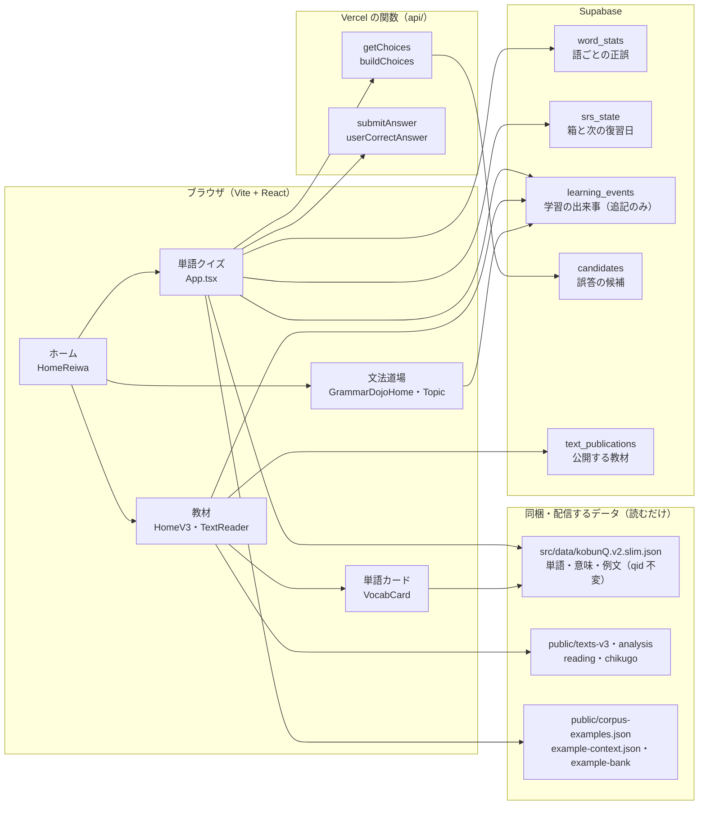

- 単語の正本は Excel（`F:\古文単語テストリスト (回復済み).xlsx`）で、`kobunQ.v2.slim.json` はそこから作る。qid は変えない。
- `learning_events` は分析用の追記だけ。学習の進み方を決めるのは `word_stats` と `srs_state`。
- 文法道場の表（ドリル・単元の進み具合）はこの図に入れていない（見直し中）。

## 2. 画面のつながり

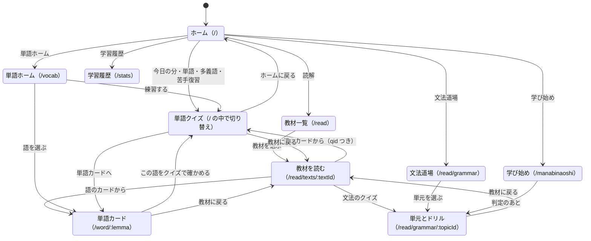

- ホームと単語クイズは同じアドレス `/` で、`App.tsx` の `showHome` で切り替える。ほかは `src/main.tsx` の経路。
- 教材を読む画面の下段から、解説（`/guide`）・問題（`/test`）・品詞分解PDF（`/print`）へ行ける。図では省いた。
- `/?mode=word`・`/?mode=polysemy` で開くと、ホームを挟まずクイズが始まる。単語ホームの「練習する」はこれを使う。
- 戻り先は来た所へ：単語カードと単元ページは `?back=` を受け取る（`src/lib/returnTo.ts` の `safeReturnPath`・`safeDojoBackPath`・`returnLabels`）。
- ほかの経路：`/search`（検索）・`/texts`（旧教材一覧）・`/tango-dojo`（見分ける）・`/read/vocab`（単語帳）・`/read/reference`（文法の解説）・`/read/grammar/reibun`（例文事典）・`/account`・`/teacher`。

## 3. 単語クイズの画面の状態

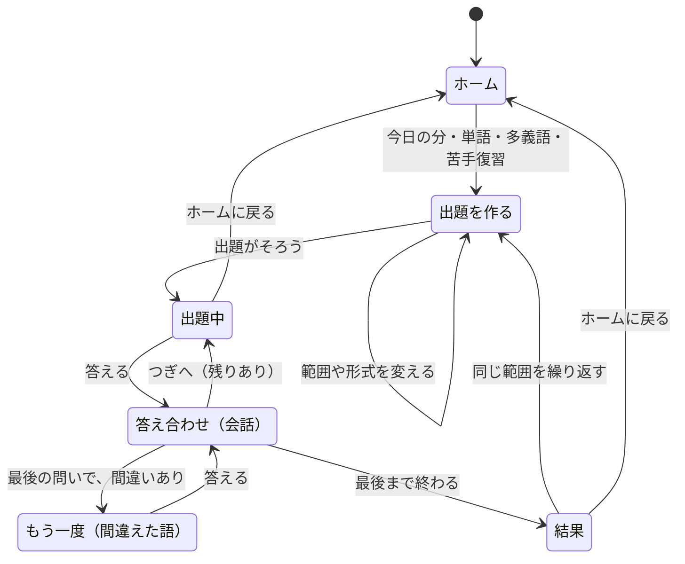

- 状態を持つ変数：`showHome`・`isQuizActive`・`showResults`・`currentQuestionIndex`・`currentQuizData`。モードは `currentMode`（`word`／`polysemy`）、入口の種類は `quizMode`（`normal`・`weak`・`focus`・`today`）。
- 「出題を作る」は範囲・形式・問題数・モードを変えるたびに走る。あとから始めた作り直しだけを反映する（`setupSeqRef`）。
- 「もう一度」は、最後の問いのあと、間違えた語を1回だけ後ろに足す（`buildRetryRound`）。練習扱いで、記録と点数には入れない。
- 多義語モードの ○×・例文理解・文脈記述は、答え合わせが会話ではなく従来の表示。

## 4. 1問の状態（形式と判定）

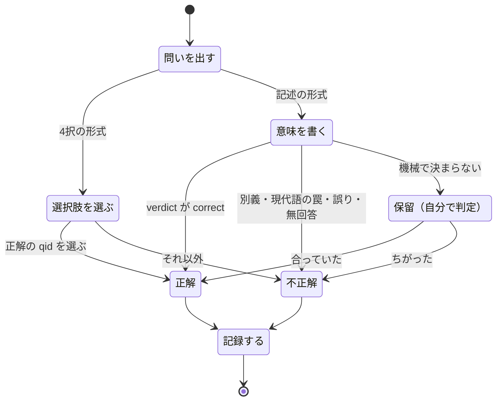

- 4択の形式：`word-meaning`（語から意味）・`word-reverse`（意味から語）・`sentence-meaning`（例文から意味）・`blank-fill`（空欄）。記述は `meaning-writing`。
- 記述の判定は `judgeWritingAnswer`（`src/lib/writingJudge.ts`）。記録は最終判定の1回だけ（`finalizeWriting`）。
- 保留のあいだは「つぎへ」を出さない。出口は「合っていた」「ちがった」の2つだけ（2026-11-06。前は判定せずに進めて、記録が残らなかった）。
- 形式「おまかせ」は箱で問い方を上げる：箱1 `word-meaning` → 箱2〜3 `sentence-meaning` → 箱4 `blank-fill`（空欄が無い語は `sentence-meaning`）→ 箱5 `meaning-writing`。
- 箱3以上の語は、例文を教材の実戦例文（`public/corpus-examples.json`）に差し替える。

## 5. 単語の箱（SRS）

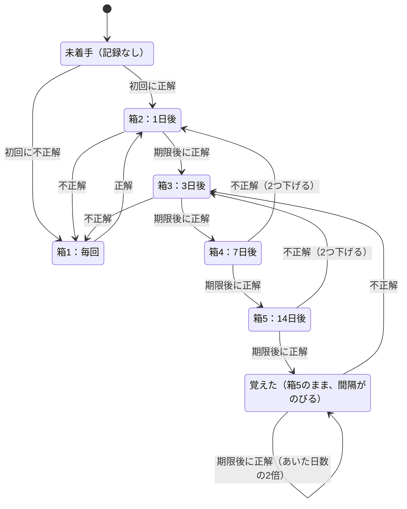

- 計算は `nextBox`・`reviewTransition`・`graduatedIntervalDays`（`src/lib/srsEngine.ts`）。日数は `BOX_INTERVALS_DAYS`。
- 期限より前に正解しても、箱も次の復習日も動かない（練習扱い）。
- 卒業（2026-11-06）：箱5で期限後に正解したら、箱は5のまま、次の復習を「前回の復習からあいた日数の2倍」にする。下限28日・上限120日（`GRADUATED_MIN_DAYS`・`GRADUATED_MAX_DAYS`）。DB の箱は1〜5の決まりなので、箱6は作らない。
- 落ち方（同日）：不正解は、箱4・5なら2つ下げる。箱1〜3は箱1へ。
- 文法ドリルの記録も同じ計算を使う。

## 6. 出す語の決め方（おまかせ選択）

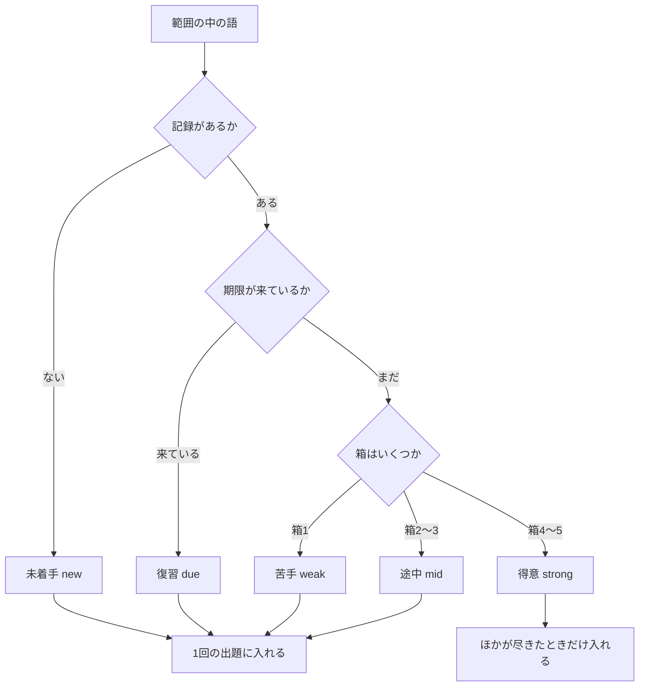

- 分類は `classify`、配分は `pickQuestions`（`src/lib/quizSelector.ts`）。期限が来た語は `getDueAmong`（`src/lib/srsEngine.ts`）で取り、単語クイズのおまかせ選択が渡す（2026-11-06）。
- 期限が来た語があるとき：復習 40%（古い順）・苦手 30%・未着手 30%（番号順）・残りを途中から。足りなければ 復習の残り → 苦手の残り → 未着手の残り → 途中 → 得意 の順で補う。1問目は 復習・苦手・未着手 のどれか。
- 期限が来た語を渡さないとき（文法ドリル・今日の分の補充）：苦手 40%・未着手 30%・残りを途中から。
- 箱の記録があれば箱だけで決める（同日。前は誤答率を先に見ていたので、箱が高くても苦手に入り続けた）。箱の記録が無い語だけ、正誤の累計で決める（誤答率 40% 以上＝苦手、3回以上答えて 20% 以下＝得意）。

## 7. シーケンス：単語クイズの出題を作る

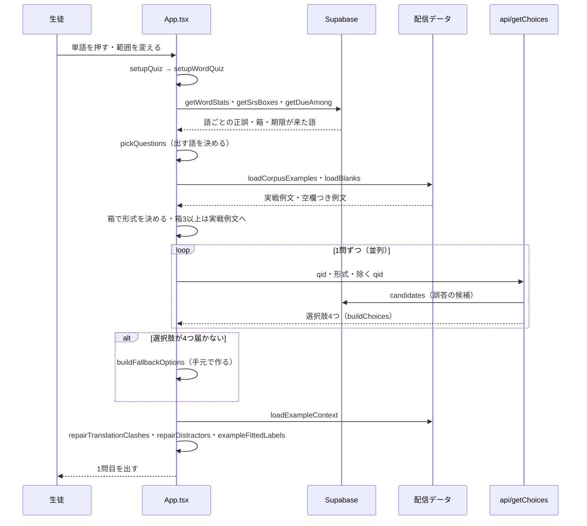

- 選択肢の決まり（正解と同じ意味・表記ちがい・意味が重なる組を誤答に入れない）は `src/lib/senseEquivalence.ts` にあり、関数と手元の両方が使う。
- 誤答の候補は、関数も手元も「番号が前後10以内の語 → 残り」の順に選ぶ（`nearbyFirst`）。
- 学習記録が取れないときは、出す語をランダムに選んで続ける。

## 8. シーケンス：回答から結果まで

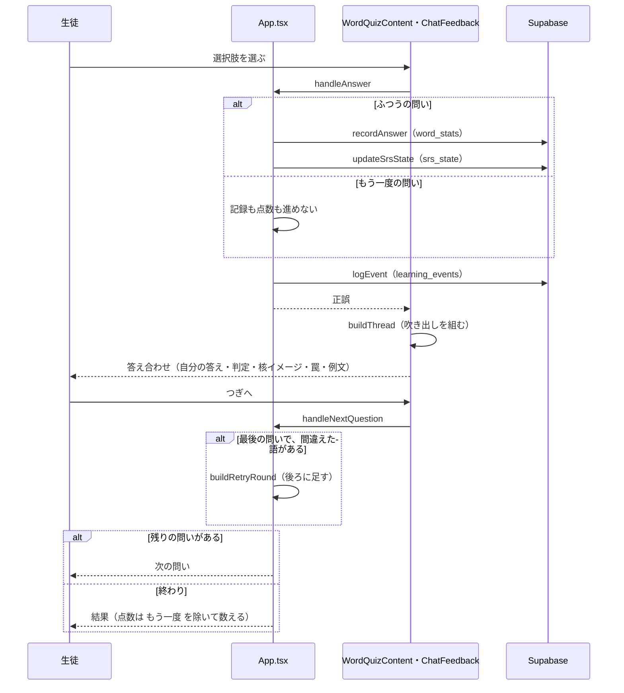

- 記録の2つ（`recordAnswer`・`updateSrsState`）は待たずに送る。失敗しても出題は続く。
- 記述のときは `handleWritingSubmit` → `judgeWritingAnswer` → `finalizeWriting`。回答の本文は `api/submitAnswer` へ送る（もう一度の問いでは送らない）。

## 9. シーケンス：今日の分

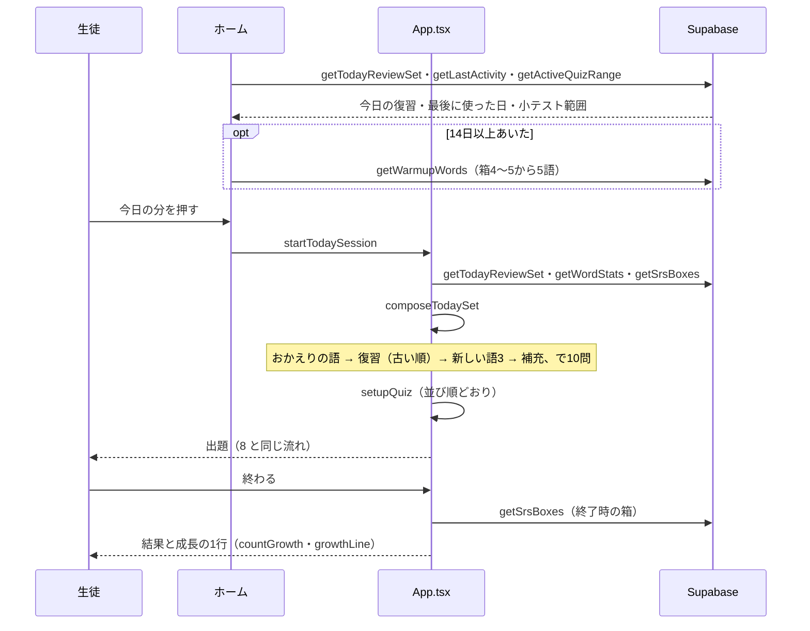

- 組み立ては `composeTodaySet`（`src/lib/todaySession.ts`）。新しい語の枠は `MIN_NEW_PER_DAY` = 3（2026-11-05。前は復習だけで10語に届くと新しい語が入らなかった）。
- 今日すでに解いた語は、今日の復習に入れない（箱1の語が何度も戻るのを防ぐため）。
- 小テスト範囲から始めたときは、範囲の外の復習語を混ぜない。

## 10. シーケンス：教材を読む

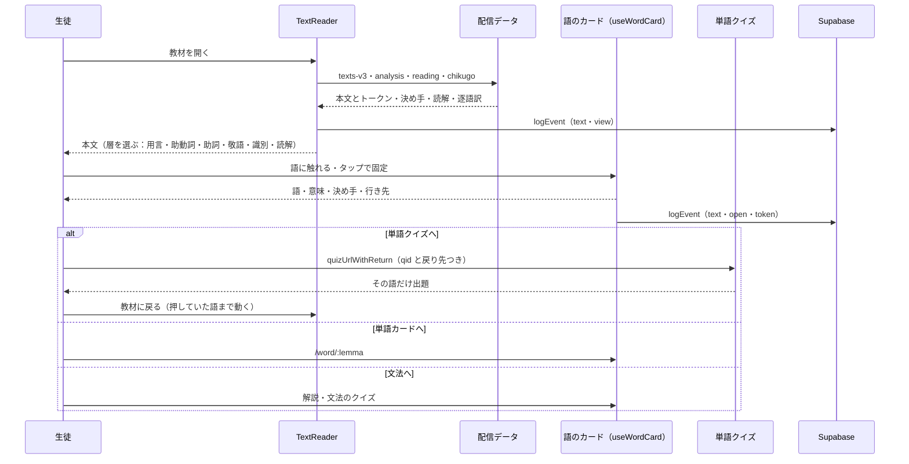

- 層の並びは `LAYER_ORDER`（用言・助動詞・助詞・敬語・識別・読解）。識別の層では語のカードを出さず、識別の出題を使う。
- 教材は公開の表（`text_publications`）にあるものだけ一覧に出る。
- 戻り先は `src/lib/returnTo.ts`（`makeReturnTo`・`quizUrlWithReturn`・`tokenIdFromHash`）。

## 11. 起動と利用者

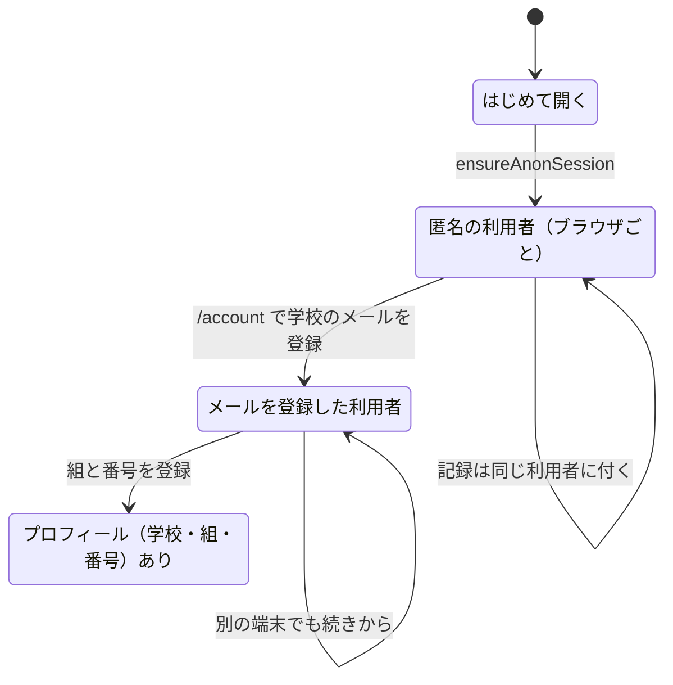

- 匿名の記録は、登録しても同じ利用者に残る。別の端末の匿名の記録は、端末の統合（`merge_user_progress`）で付け替える。
- 登録を必須にする切り替えは環境変数 `VITE_AUTH_REQUIRED`（既定はオフ。`src/components/RequireAccount.tsx`）。

---

## 図に入れていないこと

- 文法道場の中（ドリルの出し方・復習・レベル）と学び始め。2026-11-06 に見直しを入れた。今の作りは `CLAUDE.md` の「文法道場の見直し」の行、見直しの前の作りと問題点は `F:\A2A\_work\kobun-ia\grammar-dojo-review.md`。
- 多義語モードの3形式の細部、読解テスト、教員の画面、動画の配信（R2）。
- 数字（利用者数など）。利用の集計は `F:\A2A\_work\kobun-ia\` にある。
